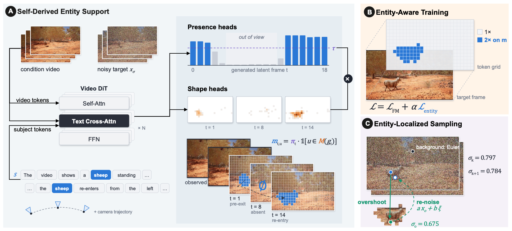

<h1 align="center">ReentryMem</h1>

<p align="center">
  <strong>Out of View, Still in Motion:<br>Dynamic Entity Re-entry in Video World Models</strong>
</p>

<p align="center">
  <a href="https://reentrymem-project.pages.dev/">🌐 Project Page</a> &nbsp;|&nbsp;
  <a href="https://huggingface.co/larry077/ReentryMem">🤗 Model</a> &nbsp;|&nbsp;
  <a href="LICENSE">License</a>
</p>

ReentryMem is a self-localized framework for dynamic entity re-entry in video world models. It reads entity regions directly from noisy video latents and uses the same localization mechanism to guide training and sampling, improving recovery when a moving subject leaves the camera's view and later returns.

This repository provides inference code and the trained single-entity **Wan2.2-TI2V-5B** checkpoint.

## Demo

https://github.com/user-attachments/assets/528da459-6a8b-41cf-b3ea-e98fd0a738e4

Visit the [project page](https://reentrymem-project.pages.dev/) for the method, synchronized comparisons, and more qualitative results.

## Method



ReentryMem connects three components:

1. **Self-localized entity regions.** Text cross-attention provides separate signals for entity presence and spatial shape during denoising.
2. **Entity-weighted training.** The predicted regions emphasize the entity in the flow-matching objective.
3. **Localized sampling.** Overshooting and re-noising correct the predicted entity region while the background follows the standard Euler update.

The localization mechanism operates on noisy latents without intermediate RGB decoding or an external segmentation model. Ordinary Euler sampling and localized sampling use the **same trained checkpoint**.

## Results

The controlled comparison reported on the [project page](https://reentrymem-project.pages.dev/#comparisons):

| Method | Rea-Score (%) ↑ | SC ↑ | TCM ↑ |
|---|---:|---:|---:|
| Baseline | 96.1 | 0.8204 | 0.9154 |
| ReentryMem-Train | 99.2 | 0.8380 | 0.9231 |
| **ReentryMem** | 97.2 | 0.8378 | 0.9318 |

Rea-Score measures entity reappearance, SC measures subject consistency, and TCM measures temporal consistency match. ReentryMem-Train uses Euler sampling; ReentryMem adds localized sampling to the same weights. See the project page for the evaluation protocol and comparisons with other world models.

## Quick Start

### Installation

Use Python 3.10 or later with CUDA-enabled PyTorch. FlashAttention is optional; fused PyTorch attention is used when it is unavailable.

```bash
git clone https://github.com/Larry-077/ReentryMem.git
cd ReentryMem

conda create -n reentrymem python=3.11 -y
conda activate reentrymem
pip install -r requirements.txt
```

### Download the model

| Model | Backbone | Precision | Resolution | Download |
|---|---|---|---|---|
| ReentryMem | Wan2.2-TI2V-5B | BF16 | 832×480 | [Hugging Face](https://huggingface.co/larry077/ReentryMem) |

```bash
python tools/download_models.py \
  --repo-id larry077/ReentryMem \
  --checkpoint-dir checkpoints/ReentryMem
```

This downloads the complete ReentryMem DiT checkpoint and the tokenizer, text encoder, and VAE from the official Wan2.2 base model.

### Generate a continuation

Provide a **77-frame observed clip at 15 fps**, a caption, the subject phrase to track, and planned camera controls. The subject phrase must occur in the caption. Generation produces **76 future frames at 832×480**.

Create an input case with a turn-and-return camera preset:

```bash
python tools/create_case.py \
  --video /path/to/observed.mp4 \
  --prompt "A girl walks through a stylized town." \
  --subjects "girl" \
  --preset turn-return \
  --output examples/case.json
```

Run inference on a CUDA GPU:

```bash
python infer.py \
  --case examples/case.json \
  --checkpoint checkpoints/ReentryMem \
  --base-model pretrained/Wan2.2-TI2V-5B \
  --output-dir outputs/demo
```

Outputs are `video.mp4` (observed prefix and continuation), `continuation.mp4` (generated segment), and `receipt.json` (settings and runtime measurements).

<details>
<summary>Camera controls and sampling options</summary>

Use `--camera-json camera.json` instead of `--preset` for planned camera-to-world poses, or `--actions-json actions.json` for 39 latent-frame action labels. Each label is `translation * 9 + rotation`, with nine translation and nine rotation actions.

| Option | Behavior |
|---|---|
| `--sampler localized` | Default ReentryMem sampling |
| `--sampler euler` | Ordinary sampling with the same checkpoint |
| `--save-masks` | Save the entity-region fields |
| `--dry-run --verify-checkpoint` | Check the case manifest, model files, and checksums without generation |

Defaults are 50 steps, CFG 5, sigma shift 5, generation seed 42, correction seed 0, correction strength 8, and noise gate 0.92. See [the example case](examples/case.example.json) for the input schema.

</details>

## Development

```bash
python -m unittest discover -s tests -v
```

See [maintenance notes](docs/MAINTAINING.md) for checkpoint export, model-card updates, release tools, and the standalone release's validation status.

## License and Acknowledgments

Code and released weights are distributed under [Apache-2.0](LICENSE). The backbone and camera-conditioning implementation build on [Wan2.2](https://github.com/Wan-Video/Wan2.2) and [BiWM](https://github.com/LynnReal-AI/BiWM). Sampling provenance and upstream notices are preserved in [NOTICE](NOTICE).
