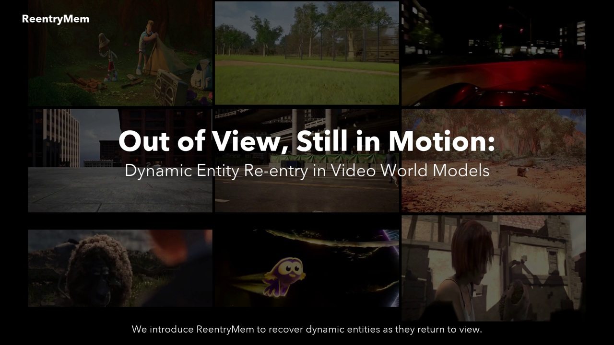

# ReentryMem

**Out of View, Still in Motion: Dynamic Entity Re-entry in Video World Models**

ReentryMem improves entity re-entry in camera-controlled video generation. It reads entity regions from text cross-attention and uses them to localize sampling correction. This repository contains inference code, calibrated region settings, and checkpoint export tools.

[](ReentryMem-final.mp4?raw=1)

[Watch the full project video](ReentryMem-final.mp4?raw=1) · 69 seconds · 1080p

## Setup

Use Python 3.10 or later with a CUDA-enabled PyTorch installation.

```bash
conda create -n reentrymem python=3.11 -y
conda activate reentrymem
pip install -r requirements.txt
```

FlashAttention is optional. Without it, CUDA inference uses fused PyTorch attention. CPU execution is provided for tests and input validation.

## Models

We release one single-entity checkpoint, trained to step **1496**. It contains the complete merged BF16 diffusion transformer and camera-conditioning parameters (5.01B parameters, approximately 10 GB). Both ordinary Euler sampling and localized sampling use this checkpoint.

The tokenizer, text encoder, and VAE come from the Wan2.2 base model:

```bash
python tools/download_models.py
```

The single-entity checkpoint is available at [larry077/ReentryMem](https://huggingface.co/larry077/ReentryMem). Download the bundle:

```bash
python tools/download_models.py \
  --repo-id larry077/ReentryMem \
  --checkpoint-dir checkpoints/ReentryMem
```

You can also export an existing checkpoint as described below. The source repository does not contain model weights.

## Inference

Each input contains a 77-frame observed video at 15 fps, a caption, entity phrases, and planned camera controls. Generation produces 76 future frames at 832×480. Entity phrases must occur in the caption. No future RGB frames or target masks are supplied to the model.

Create a case from your observed video:

```bash
python tools/create_case.py \
  --video /path/to/observed.mp4 \
  --prompt "A girl walks through a stylized town." \
  --subjects "girl" \
  --preset turn-return \
  --output examples/case.json
```

For existing planned camera poses, use `--camera-json camera.json` in place of `--preset`. Alternatively, `--actions-json actions.json` accepts 39 integer labels: 20 observed and 19 generated latent frames. The label is `translation * 9 + rotation`; each component has nine actions, including stationary.

```bash
python infer.py \
  --case examples/case.json \
  --checkpoint checkpoints/ReentryMem \
  --base-model pretrained/Wan2.2-TI2V-5B \
  --output-dir outputs/demo
```

Defaults match the main inference setup: 50 steps, CFG 5, sigma shift 5, generation seed 42, correction seed 0, correction strength 8, and noise gate 0.92. `--sampler euler` uses the same weights with ordinary sampling. `--save-masks` additionally saves the entity-region fields.

Outputs are `video.mp4` with the observed prefix and continuation, `continuation.mp4` with the generated segment, and `receipt.json` with the settings and runtime measurements.

```bash
python infer.py \
  --case examples/case.json \
  --checkpoint checkpoints/ReentryMem \
  --base-model pretrained/Wan2.2-TI2V-5B \
  --dry-run --verify-checkpoint
```

The released checkpoint is trained for single-entity re-entry. Set `subjects` to the entity phrase to track in the caption.

## Validation

The CPU tests cover input contracts, dense and causal model forwards, entity-attention hooks, mixed precision, localized updates, and video I/O. The released checkpoint's 829 tensor names and shapes match the inference model, and strict loading of the full weights has passed on CPU. A tiny forward pass with the full trained weights and calibrated region hooks has also passed using synthetic text embeddings. Bundle checksums and CLI preflight have passed.

Full-resolution CUDA generation has not yet been verified for this standalone release. On a CUDA machine, run the inference command above with a real observed clip; successful generation should produce `video.mp4`, `continuation.mp4`, and `receipt.json`.

## Checkpoint export and Hugging Face

Export a model folder without optimizer state or training data:

```bash
python tools/export_checkpoint.py \
  --checkpoint /path/to/checkpoint \
  --output-dir /path/to/ReentryMem-model \
  --name ReentryMem --variant single-entity --step 1496
```

The bundle contains the merged transformer, architecture configuration, calibrated regions, inference defaults, model card, license, and SHA256 checksums. `--hardlink` can stage the weights locally without an additional copy; exported linked weights must remain unchanged.

Create a Hugging Face token with write access, then sign in and check the bundle without uploading:

```bash
hf auth login
hf auth whoami
python tools/upload_weights.py \
  --bundle /path/to/ReentryMem-model \
  --repo-id larry077/ReentryMem --dry-run
```

Upload the same single-entity bundle:

```bash
python tools/upload_weights.py \
  --bundle /path/to/ReentryMem-model \
  --repo-id larry077/ReentryMem --public
```

The upload starts in a new or private model repository and makes it public after remote file sizes and hashes match the bundle. Temporary connection errors are retried, checking for a successful commit before uploading again. Use the same command to resume an interrupted upload; a matching public repository is accepted as already published. Weights and source code are published separately. Sign in to the `larry077` account when publishing this model.

## Publish to GitHub

Install [GitHub CLI](https://cli.github.com/) if needed, then run these commands from this directory:

```bash
git add README.md .gitignore assets/video-poster.jpg ReentryMem-final.mp4 \
  tools/export_checkpoint.py tools/upload_weights.py tests/test_upload.py
git commit -m "Prepare single-entity release and project video"
gh auth login --hostname github.com --git-protocol https --web
python tools/publish_github.py --check-auth
python tools/publish_github.py --owner Larry-077
```

Sign in to the `Larry-077` account. This creates the public [Larry-077/ReentryMem](https://github.com/Larry-077/ReentryMem) repository and pushes `main`. The script expects the repository name to be unused. For later source updates, commit the changes and run `git push`.

The README video cover links to the full MP4 included in the repository. The video is approximately 58.5 MB, below GitHub's 100 MiB file limit; push it with Git rather than the browser file uploader. See [GitHub's file size limits](https://docs.github.com/en/repositories/working-with-files/managing-large-files/about-large-files-on-github).

For an inline player in the README, upload a video attachment through GitHub's web editor and replace the video cover block with the generated attachment URL. Use a version smaller than 10 MB for free GitHub accounts. See [GitHub's attachment documentation](https://docs.github.com/en/get-started/writing-on-github/working-with-advanced-formatting/attaching-files).

## Source layout

```text
infer.py                    Inference entry point
reentrymem/pipeline.py       Video continuation and denoising
reentrymem/regions.py        Entity attention and region extraction
reentrymem/sampling.py       Localized sampling correction
reentrymem/modules/          Backbone, text encoder, and VAE
tools/                      Input preparation and model publishing
tests/                      CPU contract and numerical checks
```

```bash
python -m unittest discover -s tests -v
```

## Acknowledgments

The backbone and camera-conditioning code build on [Wan2.2](https://github.com/Wan-Video/Wan2.2) and [BiWM](https://github.com/LynnReal-AI/BiWM). Upstream attribution and sampling provenance are preserved in [NOTICE](NOTICE). The code is distributed under Apache-2.0.
